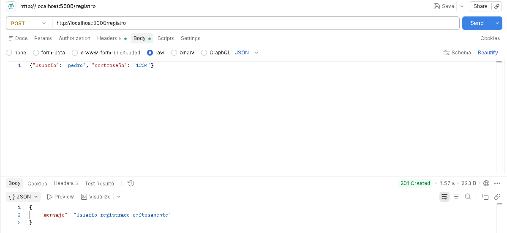
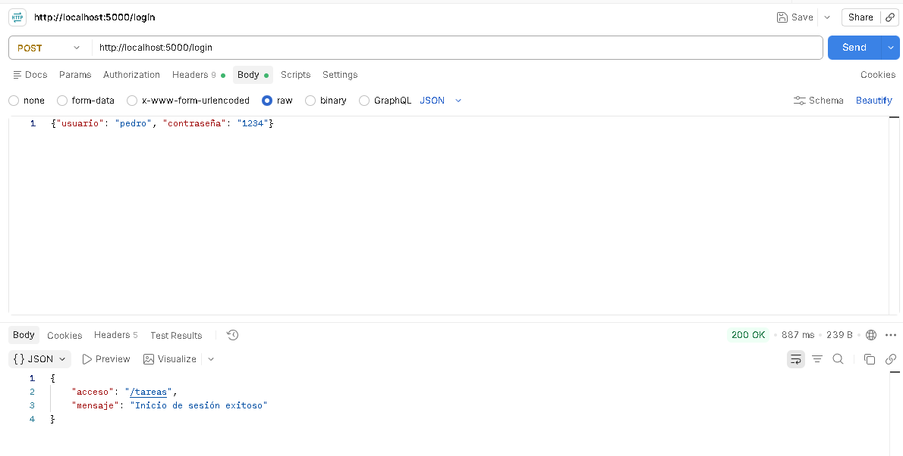
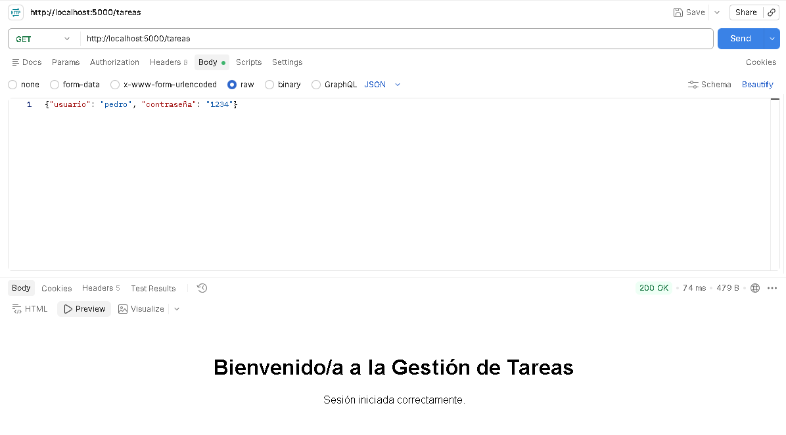

# Servidor de Autenticación

Servidor backend desarrollado con Flask y SQLite que implementa registro seguro, autenticación y visualización de recursos.

## Instalación y Ejecución

1. Instalar dependencias:
   pip install Flask werkzeug

2. Iniciar el servidor:
   python servidor.py

El servidor se ejecutará en http://localhost:5000.

## Ejecución del Cliente de Consola

Para interactuar con la API desde la terminal mediante el script `cliente.py`:

1. Instalar la librería:
   pip install requests

2. Iniciar el cliente:
   python cliente.py

Aparecerá un menú con las opciones para registrarse, iniciar sesión y consultar el endpoint de tareas.

## Pruebas de Endpoints

### 1. Registro (POST /registro)
curl -X POST http://localhost:5000/registro -H "Content-Type: application/json" -d "{\"usuario\": \"pedro\", \"contraseña\": \"1234\"}"

Respuesta esperada: 201 Created
{"mensaje": "Usuario registrado exitosamente"}

### 2. Login (POST /login)
curl -X POST http://localhost:5000/login -H "Content-Type: application/json" -d "{\"usuario\": \"pedro\", \"contraseña\": \"1234\"}"

Respuesta esperada: 200 OK
{"acceso": "/tareas", "mensaje": "Inicio de sesión exitoso"}

### 3. Tareas (GET /tareas)
curl http://localhost:5000/tareas

Respuesta esperada: 200 OK (Documento HTML de bienvenida).

